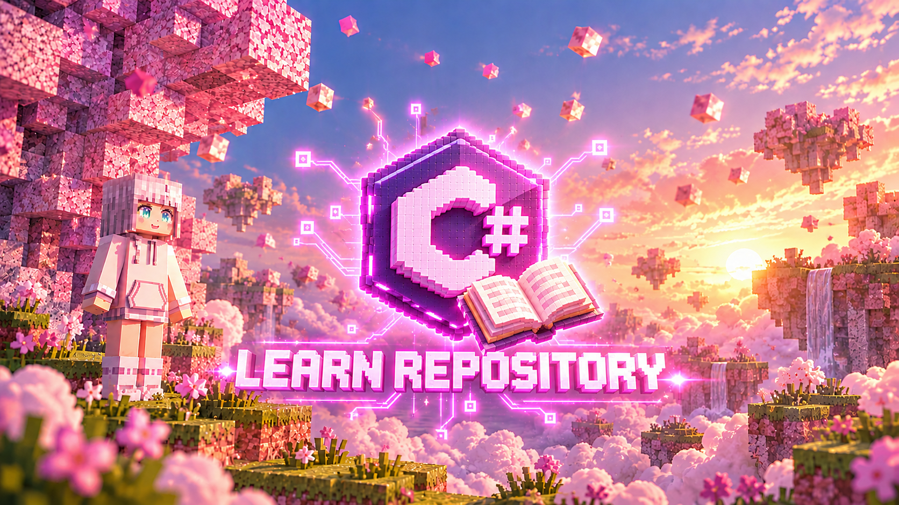

# CSharp Learn Code

  

  <strong>Fundamental C# and .NET Lessons</strong>
   
  <em>Tổng hợp các bài học cơ bản về C# và .NET</em>

  
  

---

## 📖 Overview

### 🇬🇧 English

A collection of fundamental C# and .NET lessons.

> **Note**
>
> The lessons in this repository are based on materials by JuliHyro. They may contain errors, and some parts may be difficult for certain readers to understand.
>
> Please provide constructive feedback or submit a pull request to fix any issues rather than attacking or disparaging the authors of these lessons.

### 🇻🇳 Tiếng Việt

Tập hợp các bài học cơ bản về C# và .NET.

> **Lưu ý**
>
> Các bài học trong repository này dựa trên kiến thức và tài liệu của JuliHyro. Nội dung có thể còn sai sót và một số phần có thể hơi khó hiểu đối với một số người đọc.
>
> Hãy đóng góp ý kiến mang tính xây dựng hoặc gửi pull request để sửa lỗi, thay vì công kích hay miệt thị những người biên soạn bài học.

---

## 🤝 Contributions | Đóng góp

Contributions and constructive feedback are welcome!

Mọi đóng góp và góp ý mang tính xây dựng đều được hoan nghênh!

- Report errors or suggest improvements through Issues.
- Submit pull requests to correct mistakes or improve lesson explanations.
- Keep discussions respectful and constructive.

- Báo cáo lỗi hoặc đề xuất cải thiện thông qua Issues.
- Gửi pull request để sửa lỗi hoặc cải thiện cách giải thích bài học.
- Tôn trọng mọi người và giữ cho các cuộc thảo luận mang tính xây dựng.

---

  <strong>Made by JuliHyro Founder &amp; JuliHyro Studios</strong>
   
  Learning C# and .NET, one lesson at a time.

